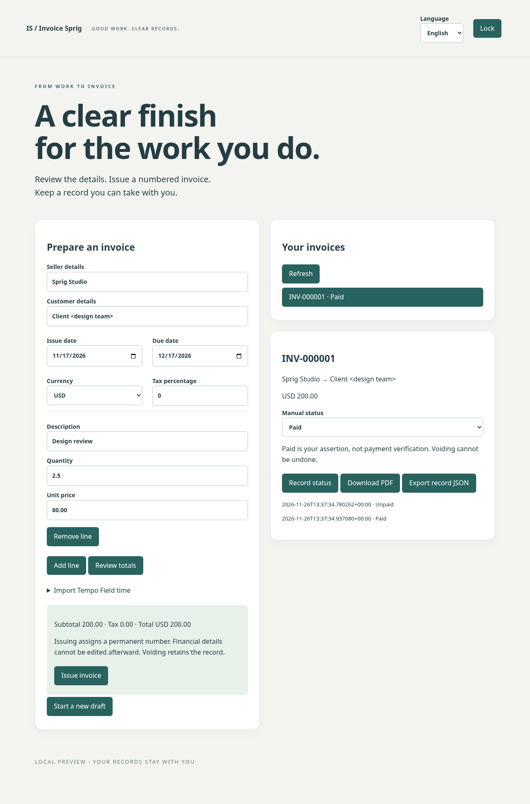

# Invoice Sprig

### From recorded work to a numbered invoice.

A local, open-source alternative to Harvest's invoicing workflow: immutable numbered invoices, exact-cent totals, PDF export and manually recorded payment status. [MIT licensed](LICENSE).



**Self-hosted preview candidate.** The browser, six-language interface, multilingual PDF export and container recovery checks are implemented. Independent source publication and hosted HTTPS acceptance remain pending. This is not a public release, hosted service, tax-compliance system or payment processor.

## Open the browser workspace

Install the dependencies below, then set a private owner key and start the local server:

```sh
export SPRIG_OWNER_KEY="$(python3 -c 'import secrets; print(secrets.token_urlsafe(40))')"
python server.py
```

Open http://127.0.0.1:8126 and unlock with that key. Keep it private. The browser stores it only in memory; reloading locks the workspace. The development server binds only localhost. See [persistent hosting and recovery](docs/DEPLOYMENT.md) for Waitress/Compose. Public HTTPS acceptance remains pending.

Enter seller/customer details, dates and line items, then **Review totals** before issuing. Browser issuance checks PDF compatibility first. Retrying an issuance uses the same request key and returns the existing invoice; use **Start a new draft** for a different invoice. After a lost response, retry without changing the draft. Do not reload while an issuance outcome is uncertain: reload clears the key; inspect the invoice list before issuing again.

Download PDFs or the full record JSON, and record paid/unpaid/void status. The time import panel replaces draft lines only after confirmation. It does not issue automatically.

## Try the workflow

Unpack the development package. Requires Python 3.12:

```sh
python3 -m venv .venv
. .venv/bin/activate
pip install -r requirements.txt
python cli.py issue examples/draft.json
python cli.py list
python cli.py pdf 1 invoice.pdf
python cli.py status 1 paid
python cli.py show 1
```

`issue` returns a numeric ID. Use that ID instead of `1` if the database already contains invoices. Review your draft before issuing: its number and financial content become immutable. Status changes have a local timestamped history. Voiding preserves the invoice and prevents reopening; issue a new invoice to correct financial content. Marking paid records your assertion, not a verified payment.

The default database is `invoices.sqlite3`; select another with `--database PATH` before the command. PDF output refuses to overwrite existing files. The CLI creates private files with mode 0600 on POSIX systems. Keep the database and exports private.

[Download the synthetic sample PDF](examples/invoice-demo.pdf).

## Import tracked time

```sh
python cli.py import-time tempo-field.json 80.00 imported-lines.json
```

This reads a Tempo Field version-1 JSON export and writes a **draft line array**. Copy the array into the `lines` field of your invoice draft, review it, then issue. Running timers are excluded. Duplicate entry IDs in one import are rejected. Imports do not know which records were billed in earlier invoices; review to avoid double billing. All completed records in the file are included, up to 100.

The hourly rate applies to every imported record. Each line retains exact seconds for charging; hours shown to six decimal places are for display. No automatic transfer, external account connection or background billing occurs.

## Calculation and limits

- USD, EUR, GBP, CAD and AUD, all with two decimal places. Decimal strings only; no floating-point money inputs.
- Each line rounds half-up to cents. Tax is calculated on the summed line cents and rounds half-up once. No discounts, exchange rates, jurisdictional rules or automatic tax determination.
- 1–100 lines; quantities up to one million, unit prices up to one million, subtotal up to one billion. Quantities support six decimal places; unit prices support two; tax supports four and is limited to 100%.
- Issued invoices cannot be edited or deleted through this tool. Local database access can still alter records; this is not a tamper-proof accounting ledger.
- The bundled PDF font supports a subset of Unicode. Unsupported characters fail explicitly instead of silently disappearing. Latin, kana and CJK extraction are tested; locale-specific glyph styling and complex-script shaping remain limited. Text entered as markup is printed literally.

## Checks

```sh
python -m unittest discover -s tests -v
```

Tests cover concurrent numbering, rounding, immutable content, status history, time import, PDF text extraction, unsupported glyph rejection and 100-line multi-page output. See [validation evidence](artifacts/validation.json) and [scope/research](docs/SCOPE.md).

## Languages and PDF coverage

English, German, Spanish, Japanese, Simplified Chinese and Traditional Chinese are bundled locally. Switching preserves draft fields, reviewed totals and the issuance retry key. Authored text is never translated. Unmapped technical errors and PDF headings remain English; browser date controls follow browser preferences. Native-speaker review remains pending.

PDFs embed the bundled SIL-OFL Noto Sans SC font, covering Latin, kana and CJK invoice text. Glyph forms use the Simplified Chinese font design; locale-specific typography and complex-script shaping are not promised. Unsupported characters, including emoji, are rejected before browser issuance. See [font provenance and license](fonts/README.md).

Fresh verification: 27 Python tests, English issuance/import browser workflows, five translated browser workflows, and catalog parity. Run `npm ci`, `npx playwright install chromium`, then `npm run test:browser` in the activated Python environment. The runner creates an isolated temporary database and stops its own test server. `CHROMIUM_PATH` can select an installed browser.
